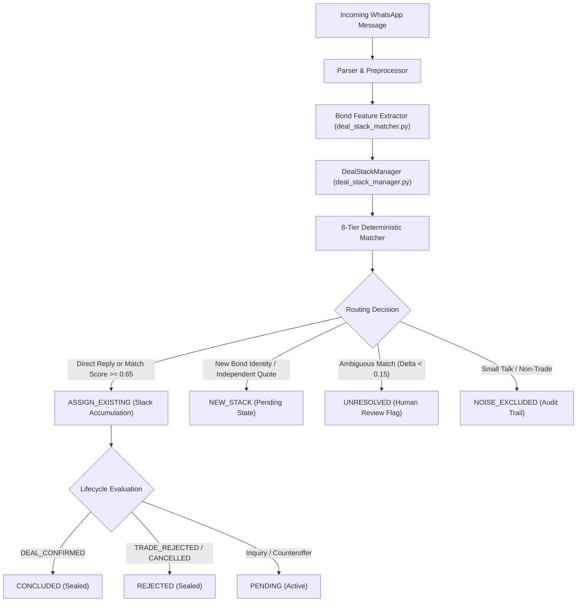

# Dynamic Deal Stacking Implementation Report: Milestone 1 Complete

## 1. Executive Summary & Core Problem Solved

In Institutional Over-The-Counter (OTC) fixed-income markets, WhatsApp channels feature multiple institutional dealers negotiating distinct bond issues simultaneously in the same chat room.

### The Legacy Bottleneck
The pre-existing implementation grouped messages using a fixed 15-minute inactivity gap (`WINDOW_GAP = 15`). If Dealer A offered an SDL 2028 at 10:00 and Dealer C sought quotes for a GS 2027 at 10:02, the legacy engine merged both dialogues into a single prompt context. When sent to the LLM, this led to:
- Cross-contamination of yields, quantities, and coupons between unrelated bonds.
- Hallucinated deal pairings.
- Misattribution of trade acceptances (`"done"`, `"sauda done"`).
- Premature termination of ongoing negotiations at file export boundaries.

### The Solution: Dynamic Deal Stacking
We have architected and implemented a deterministic multi-stack state engine that partitions, tracks, and extracts concurrent bond negotiations independently within each WhatsApp chat.



---

## 2. Phase 1: Existing Architecture Audit

### 2.1 Trace of Complete Execution Flow
```
WhatsApp Upload (.txt/.json)
    ↓
Message Parsing (`pipeline.parse_raw_chat_content`)
    • Multi-format datetime normalization (12h/24h, DD/MM vs MM/DD)
    • Message stitching, sender normalization, reply quote extraction
    ↓
Preprocessing & Noise Filtering (`pipeline.py`, `privacy.py`)
    • Sender hash & [OWN] designation
    • Noise classification (chit-chat, media, ack, system messages)
    • Lexicon hint tagging (ISIN, yield, rate, quantity, maturity, action)
    • PII masking (preserving bond identifiers, yields, and quantities)
    ↓
Context Grouping (Legacy: 15-minute chronological burst)
    • Replaced in Phase 6 with isolated Deal Stack Snippets
    ↓
LLM Extraction (`pipeline.call_llm_extraction`)
    • Formats numbered snippet per isolated deal stack
    • Calls Ollama (`gemma4:31b-cloud`) with Pydantic schema
    • Requires field-level citations (`evidence: {"ytm": ["#3"]}`)
    ↓
Validation & Normalization (`pipeline.validate_extraction`, `normalize.py`)
    • Validates line-level citations against snippet
    • Normalizes quantities (Crores, Lakhs, Units, Face Value)
    • Normalizes yields, spreads, and settlement hints (T+0, T+1, T+2)
    ↓
Bond Identification (`bond_identification.py`, `bond_matching.py`)
    • In-memory index of `ISIN_DETAILS.csv`
    • Primary matching via exact ISIN + Luhn checksum
    • Secondary matching via issuer alias, coupon rate, and maturity date
    ↓
Database Persistence (`db.persist_upload`)
    • SQLite database (`bond_deals.db`), schema version 5 (migrating to version 6)
    • Atomic persistence to `messages`, `bonds`, `transactions`, `transaction_messages`, `identification_audit`
```

### 2.2 Status Standardization
The business domain strictly enforces **three statuses**:
- **`PENDING`**: Initial status, ongoing negotiations, inquiries, counteroffers, awaiting confirmation.
- **`CONCLUDED`**: Deal explicitly confirmed by relevant parties with verifiable message evidence.
- **`REJECTED`**: Offer explicitly declined, cancelled, or abandoned.

Legacy statuses (`INITIATED`, `NEGOTIATING`, `PENDING_CONFIRMATION`, `ON_HOLD`, `UNCERTAIN`) map cleanly into `PENDING`. Internal processing statuses (`EXTRACTION_FAILED`, `UNRESOLVED`) remain internal and are never confused with business rejection.

---

## 3. Phase 2 Implementation: Models & Deterministic Matcher

### 3.1 [`deal_stack_models.py`](file:///Users/manasi/Desktop/fintech/Fintech/deal_stack_models.py)
Defines Pydantic V2 models and enums:
- **`StackStatus`**: `PENDING`, `CONCLUDED`, `REJECTED`.
- **`StackState`**: `ACTIVE`, `SEALED`.
- **`SealReason`**: `EXPLICIT_CONCLUSION`, `EXPLICIT_REJECTION`, `SUPERSEDED_NEGOTIATION`, `BATCH_END`.
- **`AssignmentDecision`**: `ASSIGN_EXISTING`, `NEW_STACK`, `UNRESOLVED`, `NOISE_EXCLUDED`.
- **`EvidenceTier`**: The 8 deterministic tiers.
- **`DealTerms`**: Accumulated financial terms with field-level evidence tracking (`field_evidence: Dict[str, List[str]]`).
- **`DealStack`**: Full container representing a single bond negotiation stack.

### 3.2 [`deal_stack_matcher.py`](file:///Users/manasi/Desktop/fintech/Fintech/deal_stack_matcher.py)
Implements deterministic matching based on the **8-Tier Evidence Hierarchy**:

1. **Tier 1: Explicit WhatsApp Reply-To Relationship (Decisive):**
   - Matches to active stack: **Score = 1.0**.
   - Matches to historical (sealed) stack: **Score = 0.95**.
2. **Tier 2: Exact ISIN Match (+0.50):**
   - Matching ISIN provides strong positive evidence.
   - **Hard Conflict:** Differing ISINs immediately trigger `is_conflicting_bond = True`, `total_score = 0.0`.
3. **Tier 3: Instrument & Issuer Identity (+0.20 to +0.40):**
   - Standard Indian instruments: `SDL`, `GS`, `TBILL`, `NCD`.
   - Known corporate issuers: `Oxyzo`, `Sammaan`, `Muthoot`, `Vedika`, `NHAI`, `HUDCO`, `PFC`, `REC`, etc.
   - **Hard Conflict:** Differing instruments (e.g., SDL vs GS) or differing issuers yield `Score = 0.0`.
4. **Tier 4: Maturity & Coupon Similarity (+0.15 to +0.35):**
   - Tenor/year matching (e.g., 2027 vs 2028).
   - **Hard Conflict:** Differing maturities yield `Score = 0.0`.
5. **Tier 5: Counterparty Continuity (+0.15 to +0.20):**
   - Existing counterparty in stack: +0.20.
   - Second counterparty answering open quote: +0.15.
   - External 3rd party initiating an opening quote: triggers `NEW_STACK` (Case C).
6. **Tier 6: Transaction Intent & Negotiation Continuity (+0.20 to +0.35):**
   - Inquiry $\rightarrow$ Quote $\rightarrow$ Counteroffer $\rightarrow$ Confirmation $\rightarrow$ Rejection.
   - Price quote answering direct inquiry: +0.35.
   - A price change alone **never** creates a new stack.
7. **Tier 7: Terms Continuity (+0.10 to +0.20):**
   - Matching quantity (+0.10) or quantity supplied for stack (+0.15).
   - Yield level within typical negotiation spread ($\le 25\text{ bps}$): +0.15.
8. **Tier 8: Time Proximity (+0.03 to +0.05):**
   - Supporting evidence only ($\le 5\text{ mins}$: +0.05; $> 4\text{ hours}$: -0.05).

### 3.3 Configurable Matching Thresholds ([`config.py`](file:///Users/manasi/Desktop/fintech/Fintech/config.py))
- `STACK_HIGH_CONFIDENCE_THRESHOLD = 0.65`: Minimum score for unreviewed assignment.
- `STACK_NEW_NEGOTIATION_THRESHOLD = 0.30`: Lower bound for viable stack candidates.
- `STACK_AMBIGUITY_DELTA_THRESHOLD = 0.15`: Ambiguity margin triggering `UNRESOLVED`.
- `STACK_TIME_DECAY_HOURS = 4.0`: Inactivity decay window.

---

## 4. Phase 3 Implementation: Dynamic Deal Stack Manager

### 4.1 [`deal_stack_manager.py`](file:///Users/manasi/Desktop/fintech/Fintech/deal_stack_manager.py)
The `DealStackManager` class orchestrates stacks per chat session:

#### Key Capabilities
1. **Per-Chat Partitioning:** Stacks are keyed by `chat_key`. Messages from `CHAT:group-A` can never match or contaminate stacks in `CHAT:group-B`.
2. **Term Accumulation:** Partially stated bond terms across successive messages (e.g., message 1: "SDL 2028", message 2: "5Cr", message 3: "7.25") are progressively accumulated into `stack.terms` without overwriting existing data. Field-level message citations are recorded in `terms.field_evidence`.
3. **Lifecycle Sealing:**
   - `conclude_stack()`: Sets status to `CONCLUDED`, state to `SEALED`, seal reason to `EXPLICIT_CONCLUSION`, moves stack to `_sealed_stacks`.
   - `reject_stack()`: Sets status to `REJECTED`, state to `SEALED`, seal reason to `EXPLICIT_REJECTION`.
   - `supersede_stack()`: Sets state to `SEALED`, seal reason to `SUPERSEDED_NEGOTIATION`.
4. **Batch-End Snapshot (`snapshot_batch_end`):**
   - At the conclusion of a file upload, active ongoing negotiations are snapshotted as `PENDING`.
   - **Active stacks are never prematurely rejected or closed.** They remain active in memory to receive subsequent messages.
5. **Multi-Upload Continuity:**
   - If a dealer posts an offer in Upload 1, and the counterparty accepts in Upload 2, the manager matches the active pending stack, appends the message, and seals the deal as `CONCLUDED`.
6. **Duplicate Protection:**
   - `_processed_message_ids: Set[str]` and `_seen_messages: Dict[str, StackAssignmentResult]` ensure that re-uploading the same chat export returns cached results without duplicating messages in stacks.
7. **Late-Arriving Message Protection:**
   - Messages arriving with timestamps earlier than `stack.last_activity_at` are flagged as late-arriving.
   - If appended to a sealed stack, a `MESSAGE_APPENDED_TO_SEALED_STACK` event is logged, but the terminal status (`CONCLUDED` or `REJECTED`) is **never regressed**.

---

